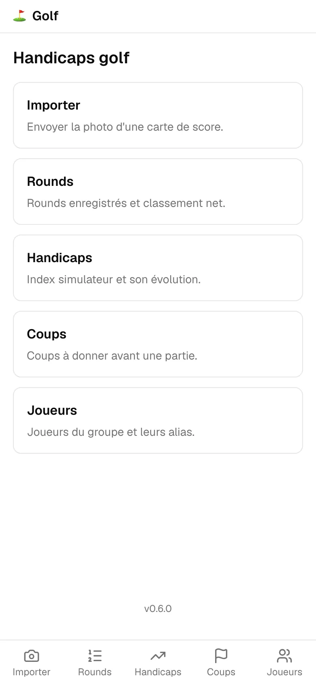
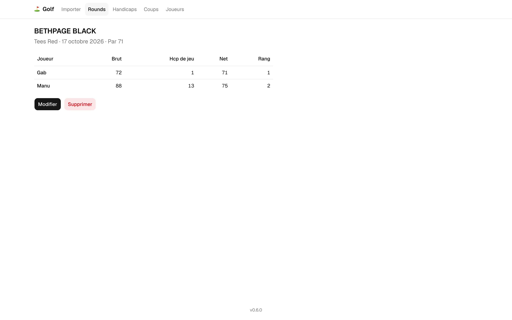

# Golf handicaps

Self-hosted web app that reads photos of GSPro simulator scorecards, keeps a group's round history and computes each player's handicap index and the strokes to give before a match.

[](https://github.com/emmpaul/golf-handicaps/actions/workflows/main.yml)
[](https://github.com/emmpaul/golf-handicaps/releases/latest)
[](https://github.com/emmpaul/golf-handicaps/releases)
[](https://github.com/emmpaul/golf-handicaps/commits/main)
[](https://github.com/emmpaul/golf-handicaps/commits/main)
[](https://github.com/emmpaul/golf-handicaps/issues)
[](LICENSE)
[](https://github.com/emmpaul/golf-handicaps/pkgs/container/golf-handicaps)

[](https://nextjs.org)
[](https://react.dev)
[](https://www.typescriptlang.org)
[](https://sqlite.org)
[](https://github.com/tesseract-ocr/tesseract)
[](https://nodejs.org)
[](https://pnpm.io)
[](https://www.docker.com)

[](https://github.com/topics/golf)
[](https://github.com/topics/handicap)
[](https://github.com/topics/gspro)
[](https://github.com/topics/ocr)
[](https://github.com/topics/tesseract)
[](https://github.com/topics/nextjs)
[](https://github.com/topics/sqlite)
[](https://github.com/topics/self-hosted)




## Features

The user interface is in French. The code, the docs and this README are in English; the specifications under `openspec/` are in French.

- **Scorecard import from a photo.** Take or pick a photo of the GSPro scorecard on your phone. The worker finds the panel on the photo by itself, then reads it with Tesseract on your server. No external service is needed.
- **Review before saving.** Every reading lands on a correction screen with consistency checks (OUT/IN/TOT sums, pars, hole indexes). Saving stays blocked until the card adds up. You can re-frame the photo by placing 4 corners, or enter a card by hand.
- **Optional AI fallback.** With an Anthropic API key, Claude frames photos local detection missed and fills in cells the OCR misread, under a monthly budget. Off by default. See [what it sends](docs/ai-fallback.md).
- **Round history.** Each round keeps its course, tees, date, pars, hole indexes, scores and photo, with a net leaderboard. Rounds can be corrected or deleted.
- **Handicap index.** A WHS-style index with each course's rating and slope, looked up on Simulator Golf Tour and confirmed by a user. A course without a confirmed rating counts at its par and a slope of 113. Provisional indexes for new players and full history.
- **Strokes to give.** Pick 2 to 4 players and a known course: the app tells each player how many strokes they get and on which holes.
- **Players and aliases.** Names read on a card are matched to players through aliases the app learns as you correct.
- **Built for phones.** Installable on the home screen, with a bottom tab bar and large touch targets under 768 px.
- **Shared passcode.** One code for the whole group, no accounts.

## Quick start

You need Node (version in [`.nvmrc`](.nvmrc)), pnpm through corepack, and `tesseract` in your `PATH` (`brew install tesseract` on macOS).

```sh
git clone https://github.com/emmpaul/golf-handicaps.git
cd golf-handicaps
corepack enable
pnpm install
cp .env.example .env.local   # then set APP_PASSCODE and SESSION_SECRET
pnpm db:reset                # creates data/app.db with 3 players and a reference round
pnpm dev                     # web on http://localhost:3000 and the worker
```

Open <http://localhost:3000> and enter the `APP_PASSCODE` you set.

To run the published image instead, see [Deployment](docs/deployment.md). To run it locally with Docker Compose, see [Development](docs/development.md#production-like-run-with-docker).

### Releases and image tags

[release-please](https://github.com/googleapis/release-please) reads the Conventional Commits merged into `main` and keeps a release PR open with the next version and its [CHANGELOG.md](CHANGELOG.md) entry. A `feat` bumps the minor version, a `fix` the patch. Merging that PR creates the git tag `vX.Y.Z` and a [GitHub release](https://github.com/emmpaul/golf-handicaps/releases).

Only a release publishes an image. The CI builds `linux/amd64` and `linux/arm64` on native runners, then pushes one multi-arch index to [GHCR](https://github.com/emmpaul/golf-handicaps/pkgs/container/golf-handicaps) under three tags:

| Tag | Points to |
| --- | --- |
| `vX.Y.Z` | That release. Pin it to deploy or roll back to a known version. |
| `latest` | The most recent release. |
| `<sha>` | The full sha of the release commit. |

The image carries the OCI label `org.opencontainers.image.revision`, set to that sha, and the release notes give the index digest and the `docker pull` command.

To see which release a running instance serves, call `GET /api/version`. It needs no session and returns `{"version":"0.6.0","commit":"<sha>"}`. The same version shows at the bottom of every page.

More in [CI and releases](docs/ci.md#releases) and [Deployment](docs/deployment.md#check-what-is-running).

## Architecture

Next.js (standalone output) and SQLite. One Docker image runs as two processes that share the database on one volume:

- **web** (`node server.js`) serves the pages and the API, applies migrations at startup and queues each uploaded photo as a job;
- **worker** (`node worker.js`) polls the job queue, finds the panel on the photo, reads it with Tesseract and, if configured, asks Claude for help. It also looks up each new course's rating and slope on Simulator Golf Tour.

Both must run on the same host. Details, with a diagram, in [Architecture](docs/architecture.md).

## Configuration

All configuration comes from environment variables. The image holds no secret. In development, copy [`.env.example`](.env.example) to `.env.local`. The web and the worker both refuse to start when a required variable is missing or invalid.

| Variable | Required | Role |
| --- | --- | --- |
| `APP_PASSCODE` | yes | Shared passcode, entered on `/login`. |
| `SESSION_SECRET` | yes | HMAC secret that signs the session cookie (valid 90 days). At least 32 characters, for example `openssl rand -hex 32`. Changing it closes every session on every device. |
| `DATA_DIR` | no | Folder for the `app.db` database and the `uploads/` photos. Defaults to `./data` in development and `/data` in the image. |
| `INITIAL_PLAYERS` | no | Players the web process creates on first start, on a database with no player. Comma-separated, for example `Manu,Gab,Sean`; each gets its name in capitals as alias. Missing or empty: no player, add them on `/players`. Ignored once the database has players. Two names equal apart from case stop the startup. |
| `ANTHROPIC_API_KEY` | no | Anthropic API key, read by the worker only. Missing or empty: no AI call at all, neither framing nor completion. |
| `AI_MONTHLY_BUDGET_USD` | no | AI spend cap per calendar month, in US dollars (number > 0). Defaults to 1. An empty value counts as unset. |
| `AI_BUDGET_TIME_ZONE` | no | IANA time zone in which the AI budget month is counted, for example `Europe/Paris`. Defaults to `America/Montreal`. An empty value counts as unset. An unknown zone stops both the web and the worker at startup. |
| `SGT_LOOKUP` | no | `on` (default) or `off`, read by the worker. `on`: the worker searches each new course's rating and slope on Simulator Golf Tour, with requests to `simulatorgolftour.com` (see [Outgoing requests](docs/deployment.md#outgoing-requests)). `off`: no request to SGT, ratings are entered by hand on `/courses`. An empty value counts as unset. Any other value stops both the web and the worker at startup. |
| `TESSERACT_BIN` | no | Path to the Tesseract binary. Defaults to `tesseract` from the `PATH`. |

Build argument: `GIT_COMMIT`, the full sha of the commit being built. The CI sets it, and the app shows it in the footer and in `GET /api/version`. Without it, the commit is `null`.

## Documentation

- [Architecture](docs/architecture.md): processes, job queue, panel detection, OCR, handicap calculation, course ratings.
- [AI fallback](docs/ai-fallback.md): when Claude is called, what is sent to Anthropic, costs, budget, activation.
- [Deployment](docs/deployment.md): Dokploy setup, outgoing requests, course ratings update, worker health check, checking the running version, closing every session, backup, rollback.
- [CI and releases](docs/ci.md): checks, documentation-only scope, e2e shards, release-please, multi-arch image.
- [Development](docs/development.md): prerequisites, commands, OCR debugging, Docker Compose, DNG photos.
- [Roadmap](docs/roadmap.md): what comes next, ideas, and what was turned down and why.

## Contributing

Contributions are welcome. Read [CONTRIBUTING.md](CONTRIBUTING.md) first: branches from `origin/main`, Conventional Commits, tests first, and an OpenSpec change for any behavior change. Everyone taking part follows the [Code of Conduct](CODE_OF_CONDUCT.md). For questions, see [SUPPORT.md](SUPPORT.md).

## Security

Do not open a public issue for a vulnerability. Report it privately through [GitHub](https://github.com/emmpaul/golf-handicaps/security/advisories/new), as described in [SECURITY.md](SECURITY.md).

## License

[MIT](LICENSE) © 2026 Emmanuel Paul
