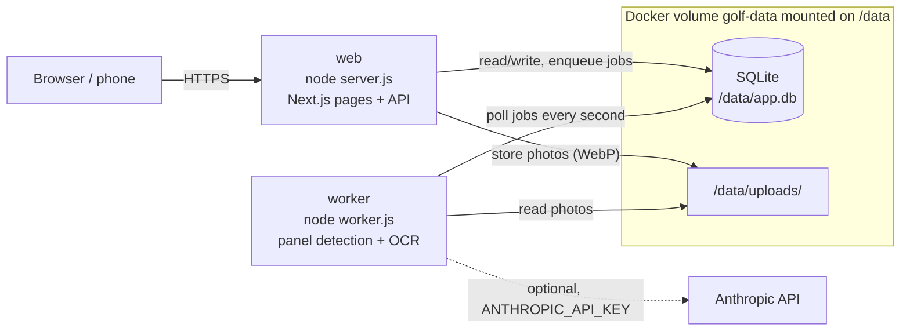

# Architecture

Golf handicaps is a Next.js app (standalone output) backed by one SQLite file. A single Docker image runs as two processes:

- the web server, `node server.js`, which serves the pages and the API;
- the OCR worker, `node worker.js`, which reads scorecard photos in the background.

Both processes open the same SQLite database on the same volume, so they must run on the same host.

## Web process

- Refuses to start when a required environment variable is missing (see [Configuration](../README.md#configuration)).
- Applies the database migrations at startup and creates the players Gab, Manu and Sean on an empty database.
- Converts photos still stored in another format to WebP in the background after startup. A photo that fails to convert stays in place and keeps being served.
- Protects every page and API route behind a shared passcode. Only `/login`, the install files (manifest and icons) and `GET /api/version` are open without a session.

## Job queue and worker

Sending a photo stores it as WebP and inserts a job in the `jobs` table, then returns at once. The worker polls that table every second, claims the next job and runs it. A job gets two attempts. After the second failure the import moves to "Échec" (failed). A job left `running` for more than 5 minutes counts as abandoned, for example when the worker was killed.

The worker waits until the web process has applied the migrations before it takes any job.

## Import without manual framing

Choosing or taking a photo queues it right away, with no corners to place. The worker looks for the GSPro panel on the photo by itself (the large light table, with the dark banner above it), taking the photo's EXIF orientation into account, then reads the card.

If it finds no framing, even after one try by the AI when it is configured (see [AI fallback](ai-fallback.md)), the import moves to "Échec" with "Panneau introuvable sur la photo" (panel not found), with no retry. The import then offers "Recadrer la photo" (re-frame the photo) or the empty correction screen.

"Recadrer la photo" also works on an import that is "Prêt à vérifier" (ready to review) and not yet saved, when the detected framing cuts off part of the table. You place the 4 corners by hand, and the new reading uses those corners without running detection again.

## OCR

Reading happens on the server, with no external service:

1. The panel is straightened (homography from its 4 corners) and cut into a grid of cells.
2. Each cell is scaled up, turned black on white and read. Digit templates built from the reference card come first; native Tesseract reads a glyph that matches no template.
3. The resulting draft goes through consistency checks: empty cells, OUT/IN/TOT sums, pars, hole indexes and scores.

When the checks fail and the AI fallback is on, the worker asks Claude to fill in only the cells in trouble. See [AI fallback](ai-fallback.md).

The user always reviews the draft on the correction screen before the round is saved. Saving stays blocked while the card is inconsistent.

## Handicap index

Each player gets an index inspired by the World Handicap System, adapted to a simulator: no course rating, slope fixed at 113. Each hole counts at most quadruple bogey, the differential of a round is the adjusted score minus the round's total par, and the index uses the WHS table on the last 20 rounds at most. With 1 or 2 rounds the index is provisional (average of the differentials). The index history is kept after each round.

Before a match, the "Coups" page gives each player the strokes they receive and on which holes, from the current indexes and the hole indexes of a known course.

## Source layout

| Path | Content |
| --- | --- |
| `src/app/` | Next.js pages and API routes |
| `src/worker.ts` | Worker entry point, bundled to `worker.js` with esbuild |
| `src/jobs/` | Job queue, panel location, OCR job, photo conversion |
| `src/ocr/` | Panel detection, straightening, cell reading, Tesseract |
| `src/ai/` | Claude calls for framing and completion, pricing, budget |
| `src/domain/` | Handicap and strokes calculations |
| `src/db/` | Drizzle schema, migrations runner, seed |
| `drizzle/` | SQL migrations |
| `openspec/` | Specifications and change proposals (in French) |
