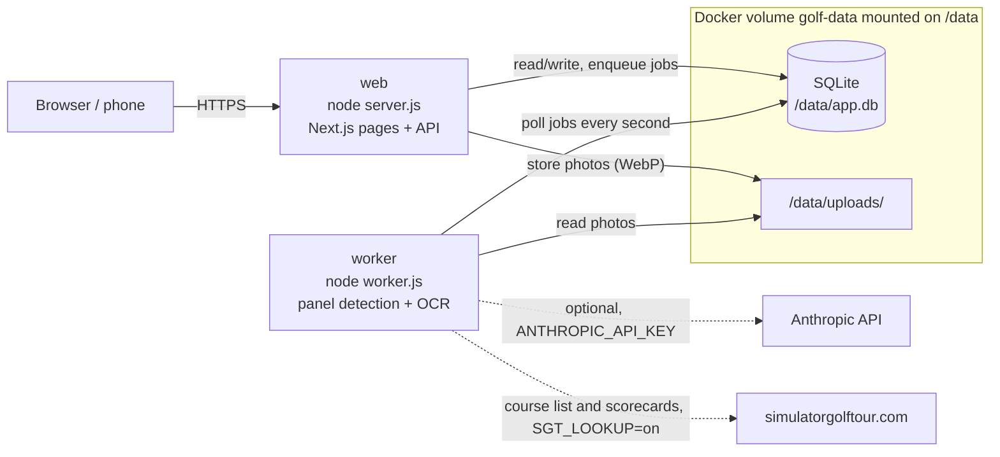

# Architecture

Golf handicaps is a Next.js app (standalone output) backed by one SQLite file. A single Docker image runs as two processes:

- the web server, `node server.js`, which serves the pages and the API;
- the OCR worker, `node worker.js`, which reads scorecard photos and looks up course ratings in the background.

Both processes open the same SQLite database on the same volume, so they must run on the same host.

## Web process

- Refuses to start when a required environment variable is missing (see [Configuration](../README.md#configuration)).
- Applies the database migrations at startup and, on a database with no player, creates the players listed in `INITIAL_PLAYERS` (none when it is unset).
- Converts photos still stored in another format to WebP in the background after startup. A photo that fails to convert stays in place and keeps being served.
- Protects every page and API route behind a shared passcode. Only `/login`, the install files (manifest and icons) and `GET /api/version` are open without a session.

## Job queue and worker

Sending a photo stores it as WebP and inserts a job in the `jobs` table, then returns at once. The worker polls that table every second, claims the next job and runs it. A job gets two attempts. After the second failure the import moves to "Échec" (failed). A job left `running` for more than 5 minutes counts as abandoned, for example when the worker was killed.

The worker waits until the web process has applied the migrations before it takes any job.

## Import without manual framing

Choosing or taking a photo queues it right away, with no corners to place. The worker looks for the GSPro panel on the photo by itself (the large light table, with the dark banner above it), taking the photo's EXIF orientation into account, then reads the card.

If it finds no framing, even after one try by the AI when it is configured (see [AI fallback](ai-fallback.md)), the import moves to "Échec" with "Panneau introuvable sur la photo" (panel not found), with no retry. The import then offers "Recadrer la photo" (re-frame the photo) or the empty correction screen.

"Recadrer la photo" also works on an import that is "Prêt à vérifier" (ready to review) and not yet saved, when the detected framing cuts off part of the table. You place the 4 corners by hand, and the new reading uses those corners without running detection again.

## OCR

Reading happens on the server, with no external service:

1. The panel is straightened (homography from its 4 corners) and cut into a grid of cells.
2. Each cell is scaled up, turned black on white and read. Digit templates built from the reference card come first; native Tesseract reads a glyph that matches no template.
3. The resulting draft goes through consistency checks: empty cells, OUT/IN/TOT sums, pars, hole indexes and scores.

When the checks fail and the AI fallback is on, the worker asks Claude to fill in only the cells in trouble. See [AI fallback](ai-fallback.md).

The user always reviews the draft on the correction screen before the round is saved. Saving stays blocked while the card is inconsistent.

## Handicap index

Each player gets an index inspired by the World Handicap System. Each hole counts at most quadruple bogey, and the index uses the WHS table on the last 20 rounds at most. With 1 or 2 rounds the index is provisional (average of the differentials). The index history is kept after each round.

The differential of a round is (113 / slope) × (adjusted score − course rating), rounded to the nearest tenth, 0.05 up. The course rating and slope are the confirmed values for the round's course and tees. A course with no confirmed rating falls back to a course rating equal to the round's total par and a slope of 113, which gives adjusted score minus par, as before ratings existed.

The playing handicap, used in a round's net leaderboard and on the "Coups" page, is the course handicap: index × slope / 113 + (course rating − total par), rounded to the nearest whole number, 0.5 up. Without a confirmed rating it is the index rounded. Allocation stays at 100 %, not the 95 % WHS recommends for individual stroke play.

Before a match, the "Coups" page gives each player the strokes they receive and on which holes, from the current indexes and the hole indexes of a known course.

### Course rating and slope

A course is a pair (course name, tees), compared without case or surrounding spaces, so "BETHPAGE BLACK / Red" and "Bethpage Black / red" share one rating. "Blue" and "Blue 6212yd" stay two courses. The `course_ratings` table holds one row per pair. Only its `rating_t` and `slope` columns enter the calculations, and only a user's confirmation writes them. One rating applies to every round on the pair, past and future, so confirming or correcting it changes the whole history of the players who played there.

The values come from [Simulator Golf Tour](https://simulatorgolftour.com) (SGT), which publishes a scorecard image with a rating and slope per tee for most GSPro courses. The worker runs the search as a `course-rating` job:

1. It downloads the SGT course list (`/courses`, a JSON block inside the page) and keeps it in memory for 24 h.
2. It looks for the course by name, ignoring case, accents, punctuation and a leading "The", at the same par as the round. One exact match is kept, with its SGT id, name and location. Several exact matches, or names that only contain one another, become candidates for the user to choose from. With no match, the row is marked not found.
3. It downloads the course's SGT scorecard and asks Claude to read the rating and slope of each tee (see [AI fallback](ai-fallback.md#reading-the-sgt-scorecard)). Without AI, or when the month's budget is short, the row waits for manual entry.
4. It matches the round's tees to a tee on the card, ignoring case, spaces and a trailing distance: "White 6023yd" matches "White". A match becomes a proposal; otherwise the user picks among the tees read.

Before step 1, the job reads the par of the most recent round on the pair. A pair with no round left (deleted or renamed since) stops there, with no request, and waits for manual entry with "Aucun round sur ce parcours" (no round on this course). An SGT request that fails, for the list or the scorecard (network, HTTP status, 20 s timeout, unexpected page format), gets one retry, then the row shows "SGT injoignable" (SGT unreachable). With `SGT_LOOKUP=off` the job stops before step 1 with "Recherche SGT désactivée" (SGT lookup off); job handlers created without options, as in tests, behave the same, so only `src/worker.ts` turns the lookup on. The job never writes `rating_t` or `slope`.

The web process queues a search for each new pair when a round is saved or corrected, inside the same transaction, and at startup for every known pair with no row yet, after the migrations (log line "Recherches de rating mises en file : N"). A pair that already has a row is never searched again on its own.

The "Parcours" page (`/courses`) lists every known course with its par, its confirmed rating ("71,4 / 144") or "sans rating", the search status and its note. Once an SGT course is retained, the card shows "SGT : <name> · <location>" (for example "SGT : Bethpage Black · Farmingdale, NY"), so a namesake on SGT can be spotted, next to links to the SGT scorecard and to [The Course View](https://thecourseview.com) (`https://thecourseview.com/courses/<slug>`, slug made from the SGT name: "Sanctuary" gives `sanctuary`, whatever the round's "THE SANCTUARY"). The Course View link is a help only and the page may not exist. A course whose row the startup sweep has not created yet shows "Recherche en cours" and nothing else. Otherwise the card offers, depending on the status:

- a proposal ("Proposition : tee Red, 71,4 / 144") with a "Confirmer" button;
- the tees read on the scorecard, each with a "Retenir" button;
- the candidate SGT courses, each with its name, location, par, a link to its scorecard and a "Choisir" button. Choosing one stores its id, name and location and runs the search again on that course;
- always, a form to enter or correct the values by hand (rating 40.0 to 90.0 with one decimal, slope 55 to 155);
- except while a search is pending, "Relancer la recherche", which clears the retained SGT course and searches again from the list. It leaves the confirmed values in place.

Confirming, keeping a tee or saving by hand writes the values and recomputes, in the same transaction, the history of every player with a round on the course. The page is not in the main navigation, and "Rounds" stays the current section on it. Links lead to it from the "Parcours" link at the top of the rounds list, from the rating line on a round's page ("Rating 71,4 · slope 144" or "Sans rating (par 71, slope 113)"), and from the rating line under the chosen course on the "Coups" page ("Rating 71,4 · slope 144" or "sans rating").

## Source layout

| Path | Content |
| --- | --- |
| `src/app/` | Next.js pages and API routes |
| `src/worker.ts` | Worker entry point, bundled to `worker.js` with esbuild |
| `src/jobs/` | Job queue, panel location, OCR job, course rating search, photo conversion |
| `src/ocr/` | Panel detection, straightening, cell reading, Tesseract |
| `src/ai/` | Claude calls for framing, completion and SGT scorecards, pricing, budget |
| `src/domain/` | Handicap and strokes calculations |
| `src/server/courses/` | Course ratings: SGT list and matching, rating lookup with its fallback, search queueing |
| `src/db/` | Drizzle schema, migrations runner, seed |
| `drizzle/` | SQL migrations |
| `openspec/` | Specifications and change proposals (in French) |
