# Refresh mobile UI

Captures de la version Fairway à 390 px, avec un pointeur tactile et les données de référence des tests. Les pages longues utilisent une fenêtre plus haute pour placer les barres fixes sous le contenu. Les tests de largeur et de cibles tactiles utilisent une hauteur de téléphone normale.

Reproduire les captures avec `pnpm e2e tests/e2e/layout-width.spec.ts --grep 390px --project chromium`. Les fichiers PNG et pièces jointes sont écrits dans `test-results/`.

| Page | Clair | Sombre |
| --- | --- | --- |
| Accueil | 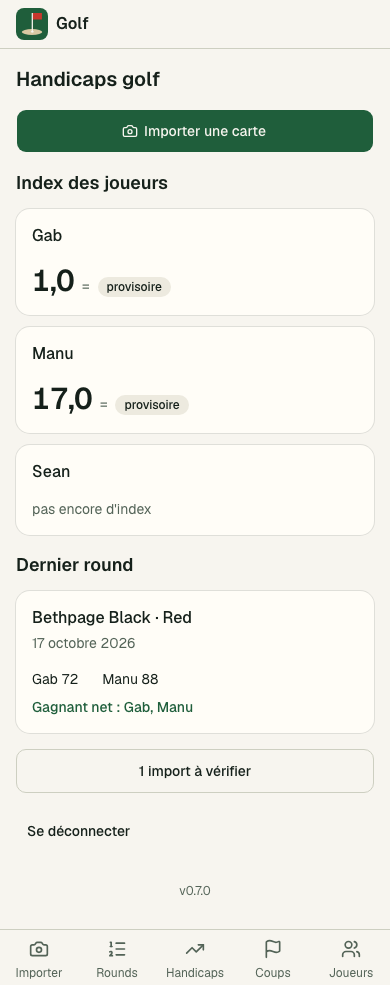 | 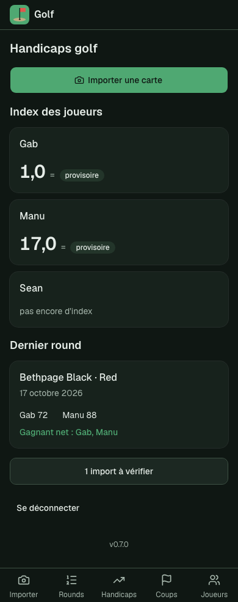 |
| Importer | 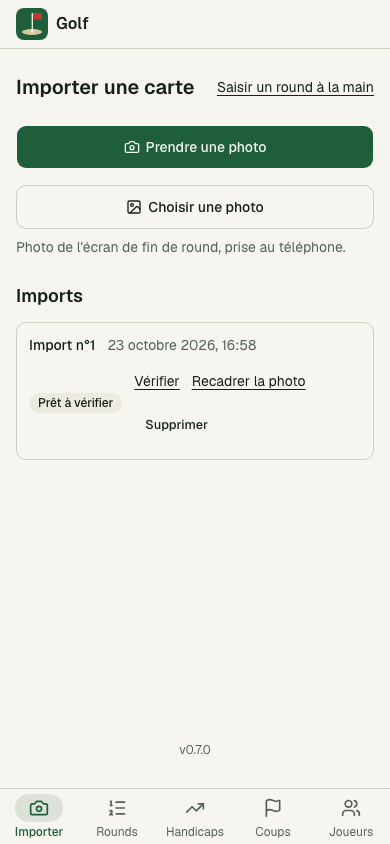 | 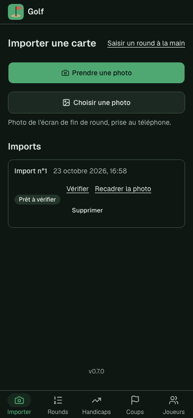 |
| Correction | 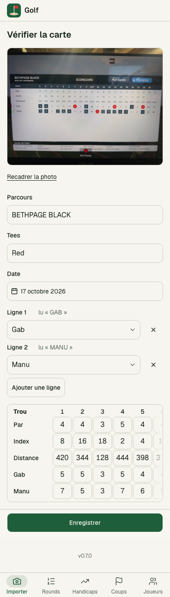 | 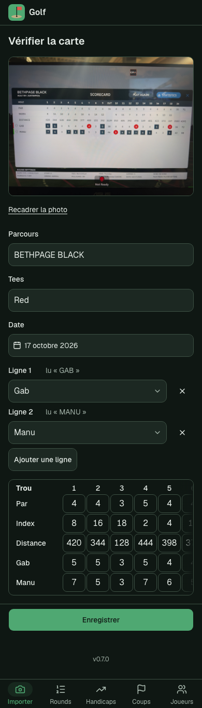 |
| Rounds | 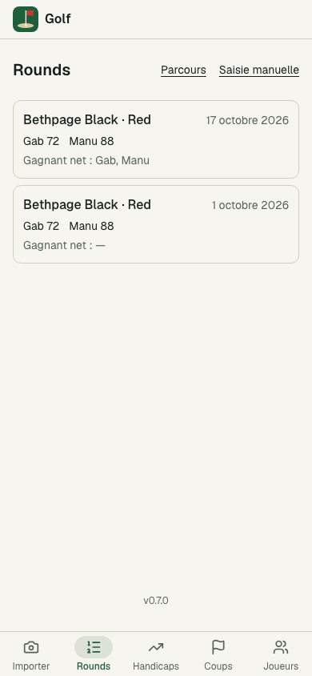 | 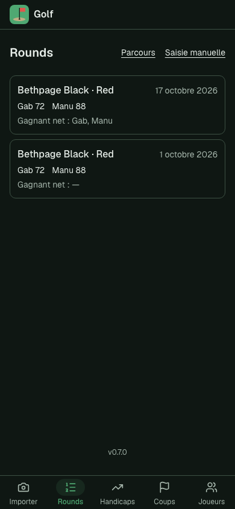 |
| Carte de score | 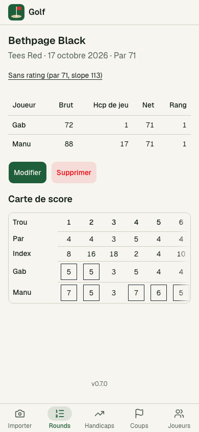 | 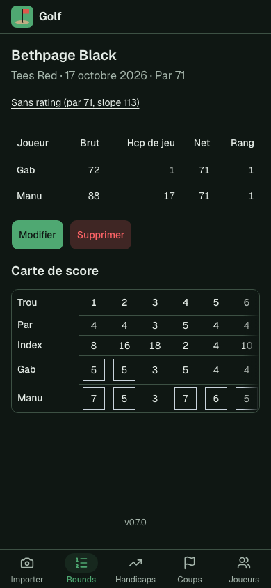 |
| Handicaps | 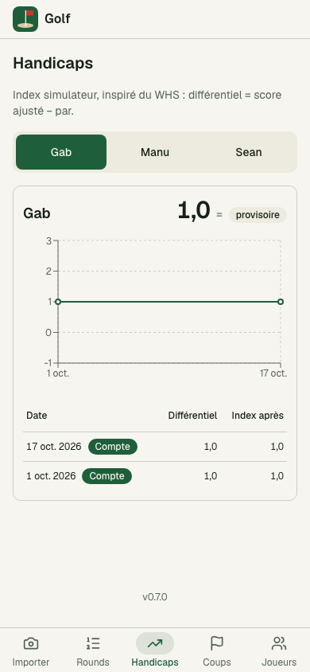 | 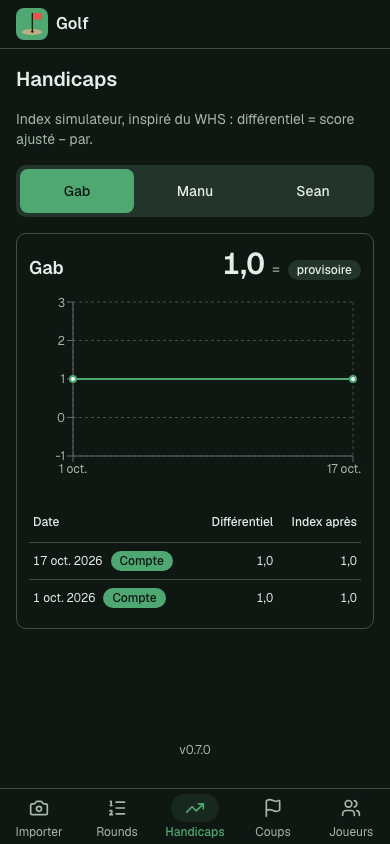 |
| Coups | 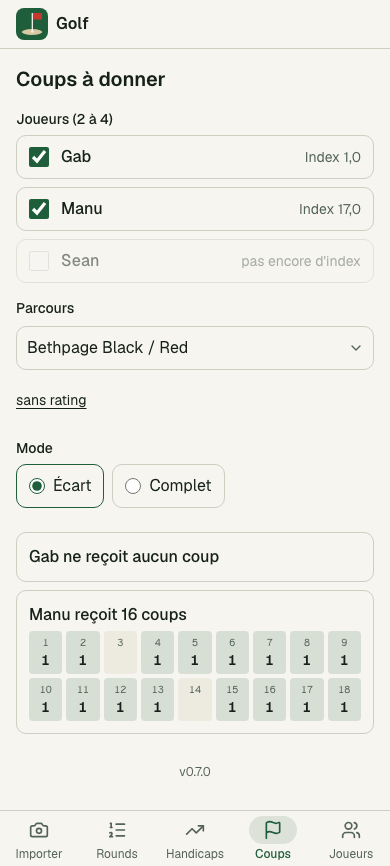 | 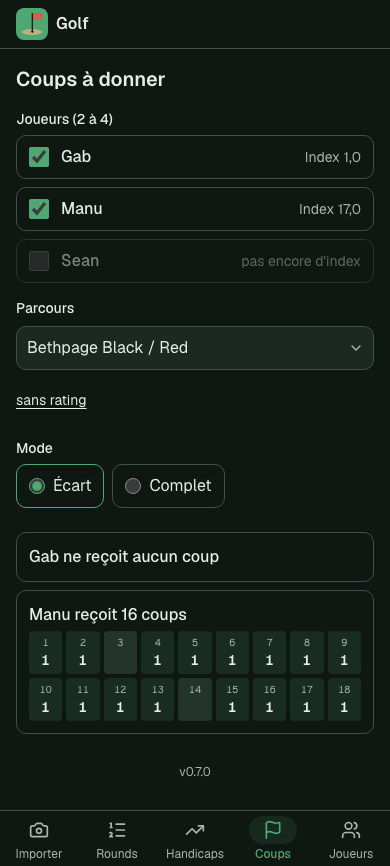 |
| Joueurs | 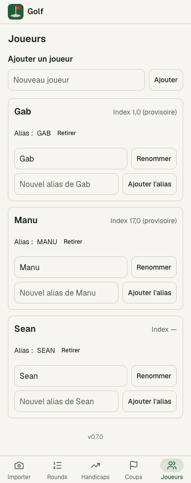 | 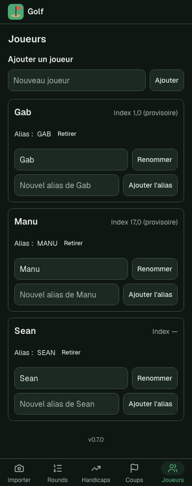 |
| Parcours | 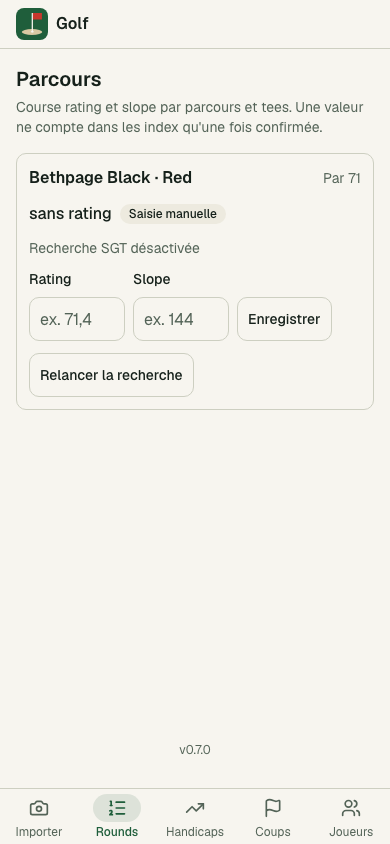 | 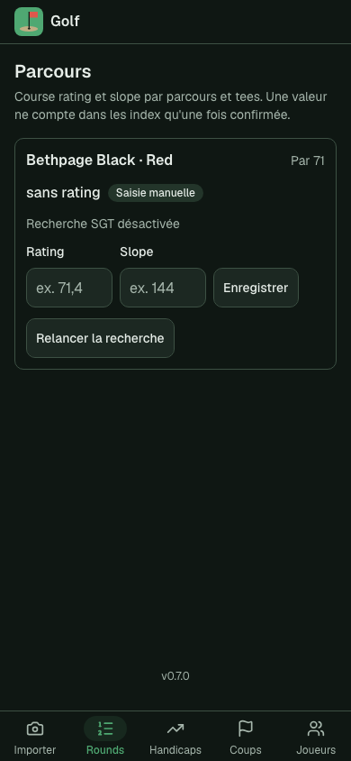 |
